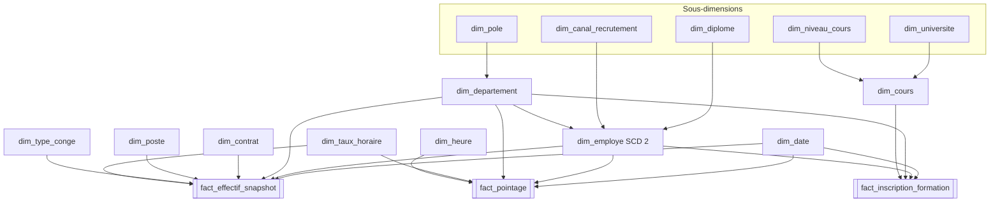

# Conception du Data Warehouse RH

> Modèle en constellation de la base `RH_Data_Warehouse`, schéma `dw`.
> Création : [`sql/data_warehouse.sql`](../sql/data_warehouse.sql). Chargement pas à pas : [GUIDE_RECONSTRUCTION_DW.md](GUIDE_RECONSTRUCTION_DW.md).

## 1. Le modèle en bref

**3 faits, 9 dimensions, 5 sous-dimensions, aucune table de pont.** Les 3 faits partagent `dim_date`, `dim_employe` et `dim_departement`, ce qui permet de croiser effectif, assiduité et formation.

### Pourquoi ce modèle

| Choix | Raison |
| --- | --- |
| Constellation (3 faits) | 3 processus métier de grain différent : la photo de l'effectif, le pointage quotidien, les inscriptions aux cours |
| Pas de table de pont | Les listes multi-valeurs sont résolues autrement : langues (4) et technologies (2) en indicateurs dans `dim_employe`, inscriptions en lignes de fait, compétences des cours en texte |
| Sous-dimensions (flocon) | Les valeurs répétées (diplôme, canal, pôle, université, niveau) sont normalisées une seule fois |
| `dim_employe` en SCD 2 | Garder l'historique d'un changement de département, d'adresse ou de statut marital |
| Pas de dimension d'anomalies | Projet académique : on reste simple. Les pointages anormaux (heures incohérentes, après la fin du contrat) sont écartés ; les incohérences de contrat, qui touchent 77 % des employés, sont gardées telles quelles |
| Pas de membre « Inconnu » | Une ligne sans correspondance ou à valeur obligatoire illisible est écartée au chargement : le DW ne contient que des données complètes |

## 2. Matrice en bus (dimension × fait)

| Dimension | fact_effectif_snapshot | fact_pointage | fact_inscription_formation |
| --- | --- | --- | --- |
| `dim_date` | snapshot, embauche, début et fin de contrat | jour pointé | snapshot |
| `dim_employe` | ● | ● | ● |
| `dim_departement` | ● | ● | ● |
| `dim_contrat` | ● | | |
| `dim_poste` | ● | | |
| `dim_type_conge` | ● | | |
| `dim_taux_horaire` | taux vacataire, taux heures sup admin | taux des heures sup | |
| `dim_heure` | | heure d'arrivée | |
| `dim_cours` | | | ● |

## 3. Tables de faits

### fact_effectif_snapshot

**Grain :** 1 employé × 1 date de snapshot. **Volume :** 2 726 lignes par snapshot (14 employés écartés). **Clé primaire :** (`date_snapshot_sk`, `employe_sk`).

| Colonne | Type | Rôle |
| --- | --- | --- |
| `date_snapshot_sk`, `date_embauche_sk`, `date_debut_contrat_sk` | int | → `dim_date` (dimension à rôles) |
| `date_fin_contrat_sk` | int NULL | → `dim_date` ; NULL = contrat sans date de fin |
| `employe_sk`, `departement_sk`, `contrat_sk`, `poste_sk`, `type_conge_sk` | int | → dimensions |
| `taux_vacataire_sk`, `taux_hs_admin_sk` | int NULL | → `dim_taux_horaire` ; NULL = non applicable |
| `salaire_mensuel` | decimal(12,2) | Mesure semi-additive |
| `heures_payees`, `heures_sup_admin` | decimal(8,2) | Mesures semi-additives |
| `cout_vacataire`, `cout_hs_admin`, `cout_total_estime` | decimal(14,2) | Mesures semi-additives |
| `conges_consommes`, `solde_conges` | decimal(5,1) | Mesures semi-additives |
| `annees_experience` | decimal(4,1) | Mesure non additive (moyenne) |
| `anciennete_jours` | int | Mesure non additive (moyenne) |
| `nb_employes` | smallint | Compteur (1) |
| `source_fichier` | nvarchar(50) | Traçabilité |

**Semi-additive :** s'additionne entre employés et départements, jamais entre deux snapshots (prendre le dernier).

### fact_pointage

**Grain :** 1 employé × 1 jour pointé. **Volume :** 169 561 lignes (103 438 écartées : heure illisible ou incohérente, employé sans fiche, jour après la fin du contrat). **Clé primaire :** `pointage_sk` (bigint IDENTITY).

| Colonne | Type | Rôle |
| --- | --- | --- |
| `date_sk`, `employe_sk`, `departement_sk`, `heure_arrivee_sk`, `taux_hs_sk` | int / smallint | → dimensions |
| `minutes_travaillees`, `minutes_pause`, `minutes_retard`, `minutes_sup` | int | Mesures additives |
| `cout_heures_sup` | decimal(12,2) | Mesure additive |
| `nb_pointages` | smallint | Compteur (1) |
| `source_fichier` | nvarchar(50) | Traçabilité |

### fact_inscription_formation

**Grain :** 1 employé × 1 cours × 1 date de snapshot. **Volume :** 18 618 lignes par snapshot (67 écartées). **Clé primaire :** (`date_snapshot_sk`, `employe_sk`, `cours_sk`). Fait sans mesure (*factless*) : il enregistre l'événement « inscrit ».

| Colonne | Type | Rôle |
| --- | --- | --- |
| `date_snapshot_sk`, `employe_sk`, `cours_sk`, `departement_sk` | int | → dimensions |
| `nb_inscriptions` | smallint | Compteur (1) |

## 4. Dimensions

| Dimension | Clé métier | Colonnes principales | Historisation | Lignes |
| --- | --- | --- | --- | --- |
| `dim_date` | `date_sk` (AAAAMMJJ) | date, jour, semaine ISO, mois, trimestre, année, jour ouvré, jour férié et libellé | Statique (2000-2030) | 11 323 |
| `dim_heure` | `heure_sk` (HHMM) | heure, minute, tranche de 15 min, après 8 h 30 | Statique | 1 440 |
| `dim_employe` | `employe_bk` | population, nom, genre, statut marital, e-mail, adresses, 4 langues, 2 technologies, `code_tenure`, diplôme, canal, département | SCD 2 (`est_courant`) | 2 736 |
| `dim_departement` | `departement_bk` | libellé, capacité, pôle | SCD 1 | 4 |
| `dim_contrat` | (`type_contrat`, `statut_emploi`) | contrat court | SCD 1 | 9 |
| `dim_poste` | (intitulé, catégorie, rang, activité) | `categorie_poste` : métier technique ou fonction administrative | SCD 1 | 1 414 |
| `dim_type_conge` | `type_conge_code` | libellé français | SCD 1 | 4 |
| `dim_cours` | `cours_bk` (`course_id`) | intitulé, université, niveau, note, URL, description, compétences | SCD 1 | 3 522 |
| `dim_taux_horaire` | `code_taux` | libellé, valeur | SCD 2 (`est_courant`) | 3 |

### Sous-dimensions

| Sous-dimension | Référencée par | Valeurs |
| --- | --- | --- |
| `dim_pole` | `dim_departement` | Technique, Administratif |
| `dim_diplome` | `dim_employe` | Licence, Master, Ingénieur, Doctorat (+ niveau bac+n) |
| `dim_canal_recrutement` | `dim_employe` | Candidature spontanée, Session de recrutement, Recommandation, Ancien vacataire |
| `dim_universite` | `dim_cours` | 185 universités |
| `dim_niveau_cours` | `dim_cours` | Débutant, Intermédiaire, Avancé, Conversant, Non calibré |

## 5. Règles de modélisation

- **Clés :** clé de substitution `_sk` (IDENTITY) sur chaque dimension, sauf `dim_date` et `dim_heure` dont la clé est lisible (AAAAMMJJ, HHMM). Les faits ne contiennent que des clés de substitution.
- **Anomalies :** pas de dimension d'anomalies. Un pointage est **écarté** quand ses heures sont incohérentes (durée négative, de moins d'1 h ou de plus de 10 h, fin avant la reprise, pause de plus de 3 h) ou quand il est postérieur à la fin du contrat. Les incohérences de contrat (CDI avec date de fin, CDD ou CIVP sans date de fin, vacataire en CDI, expérience incohérente) concernent 2 105 employés sur 2 740 : elles sont gardées telles quelles, sinon le DW serait presque vide.
- **Aucune suppression :** ni table ni ligne n'est supprimée, dans les dimensions comme dans les faits. Le chargement n'ajoute que les lignes absentes ; une version de `dim_employe` ou de `dim_taux_horaire` est clôturée (`est_courant` = 0), jamais supprimée.
- **Un Lookup par liaison, plus un :** le flux d'une table compte un Lookup par clé étrangère, plus un dernier Lookup sur la table elle-même dont la sortie *No Match* alimente la destination.
- **Lignes écartées :** pas de membre « Inconnu ». Une ligne de dimension ou de fait dont une clé n'est pas trouvée, ou dont une valeur obligatoire est vide ou illisible, n'est pas chargée. Seules les clés « non applicables » acceptent NULL : date de fin d'un contrat sans terme, taux vacataire ou taux d'heures sup admin.
- **Pas de NULL dans une clé de recherche :** un Lookup SSIS ne retrouve pas une valeur NULL. Les attributs utilisés comme clé reçoivent une valeur explicite (rang 0 = sans rang pour les administratifs).
- **Données personnelles :** nom, e-mail et adresses de `dim_employe` sont à masquer ou à filtrer dans Power BI.
- **Source unique :** toutes les tables sont chargées depuis le SA brut (`RH_Staging_Area.stg`) ; chaque correction est justifiée par une anomalie de l'audit (`eda_audit_report.html`).

## 6. Lien avec les objectifs métier

| Objectif | Tables utilisées |
| --- | --- |
| OM1 — Effectif et capacité | `fact_effectif_snapshot`, `dim_departement` (capacité), `dim_contrat`, `dim_date` (embauche) |
| OM2 — Coûts et équité | `fact_effectif_snapshot` (salaires, coûts), `dim_employe` (genre), `dim_poste`, `dim_diplome` |
| OM3 — Temps travaillé | `fact_pointage`, `dim_heure`, `dim_date` (jours ouvrés, fériés) |
| OM4 — Compétences | `fact_inscription_formation`, `dim_cours`, `dim_niveau_cours`, indicateurs de technologies |
| OM5 — Congés | `fact_effectif_snapshot` (congés), `dim_type_conge` |
| OM6 — Échéances | `fact_effectif_snapshot` (date de fin de contrat), `dim_contrat` |
