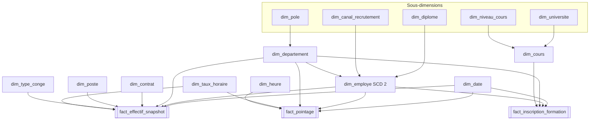

# Guide — Reconstruire le Data Warehouse RH (v2)

Mis à jour le 22/10/2026

> **Le package est construit :** `Project BI HR/Load_DW.dtsx` suit ce guide. Il diffère sur trois points, faute de pouvoir créer certains composants hors de SSDT : tables générées par une requête source, historisation SCD 2 montée avec des composants standard, boucle *For Loop* à la place de l'Unpivot (sections 3 et 4).

## 1. En bref

Ce guide décrit le DW v2 à construire à la main dans SSDT : **3 tables de faits, 9 dimensions et 5 sous-dimensions, sans aucune table de pont**. Chaque table indique sa source dans le SA, chaque colonne son origine, et chaque transformation sa raison, tirée de l'audit EDA (`eda_audit_report.html`).

### Les 3 règles du v2

1. **Pas de table de pont.** Le DW ne contient que des faits, des dimensions et des sous-dimensions (flocon). Les listes multi-valeurs de la source sont résolues autrement :
   - les **langues** (4 valeurs possibles) et les **technologies** (2 valeurs possibles) deviennent des **indicateurs oui/non** dans `dim_employe` ;
   - les **formations suivies** (liste `ID_TRAINING`) deviennent des **lignes de fait** dans `fact_inscription_formation` (un fait sans mesure n'est pas un pont : c'est un événement « employé inscrit à un cours ») ;
   - les **compétences des cours** (`Skills`) restent un texte descriptif dans `dim_cours`.
2. **Composants visuels plutôt que SQL.** Sources en mode « Table or view », Lookups en mode « Use a table or a view », nettoyage par **Derived Column**, **Data Conversion**, **Conditional Split**, **Aggregate**, **Union All**, **Lookup**, **Multicast**, **OLE DB Command**. Aucune requête SQL dans les data flows, sauf les exceptions ci-dessous.
3. **Chaque transformation a une raison écrite.** Les fiches des sections 5 et 6 donnent, pour chaque étape, l'anomalie de l'EDA qu'elle corrige ou la règle métier qu'elle applique.

### Les seules exceptions SQL, faute d'équivalent visuel

| Où | Pourquoi aucun composant visuel ne convient |
| --- | --- |
| Script de création des tables `dw` (une fois) | La structure d'une base ne se crée pas dans un data flow. Le concepteur de tables de SSMS est une alternative visuelle. |
| *Execute SQL Task* `TRUNCATE` / `DELETE` avant le chargement des faits | Une destination OLE DB ajoute des lignes mais ne peut pas vider une table. Sans cette étape, relancer le package crée des doublons. |
| Source des 2 tables générées (`dim_date`, `dim_heure`) | Aucun fichier ne contient ces lignes : une requête de la source OLE DB les génère (jours, minutes). Choix de l'équipe à la place d'un Script Component C# |
| *OLE DB Command* de l'historisation SCD 2 | Clôturer ou modifier une ligne déjà chargée exige un `UPDATE` : l'assistant Slowly Changing Dimension génère les mêmes OLE DB Command |

### Ce qui change par rapport au DW v1

| v1 | v2 | Raison |
| --- | --- | --- |
| 2 tables de pont (employé-technologie, cours-compétence) | Indicateurs dans `dim_employe`, texte dans `dim_cours` | Règle 1 |
| Requêtes SQL dans chaque source | Composants visuels | Règle 2 |
| `POSITION` copiée telle quelle (Permanent, Vacataire, Administration mélangés) | `statut_emploi` et `population` séparés | EDA : POSITION n'a pas le même sens dans les deux fichiers |
| « Ingeneering » et « Engineer » = 2 diplômes | Sous-dimension `dim_diplome` avec un seul « Ingénieur » | EDA : référentiel de diplômes différent |
| `grade` mélange métiers et fonctions | `dim_poste.categorie_poste` les distingue | EDA : GRADE ne désigne pas la même chose |
| `TENURE` lu comme « titularisé » | Gardé brut (`code_tenure`), sans interprétation | EDA : sens de TENURE inconnu |
| Pointages anormaux chargés sans distinction | Écartés au chargement (heures incohérentes, après la fin du contrat) | EDA : 31 436 journées aux heures incohérentes, 77 733 pointages après la fin du contrat |
| Audit `src_load_date`, `src_batch_id` venant du SA | Supprimé ; `source_fichier` écrit par le DW | Le SA ne contient plus que les fichiers |

## 2. Le schéma en constellation v2

Les 3 faits partagent `dim_date`, `dim_employe` et `dim_departement`, ce qui permet de croiser effectif, assiduité et formation ; les sous-dimensions (pointillés) normalisent les valeurs répétées sans aucune table de pont.

*Même schéma que dans [CONCEPTION_DW.md](CONCEPTION_DW.md).*

`dim_date` joue plusieurs rôles : jour de pointage, date du snapshot, date d'embauche, début et fin de contrat. `dim_taux_horaire` sert à l'effectif (coûts vacataires et heures sup admin) et au pointage (coût des heures sup).

## 3. Les composants SSIS à utiliser

Une douzaine de composants visuels suffisent pour tout le DW ; le tableau dit lequel prendre selon le besoin et le réglage à ne pas oublier.

| Besoin | Composant | Réglage clé |
| --- | --- | --- |
| Lire une table `stg` | **OLE DB Source** | *Data access mode* = **Table or view**, connexion SA |
| Nettoyer, calculer, mapper des libellés | **Derived Column** | Une colonne par règle ; *Add as new column* pour garder la valeur brute lisible |
| Convertir un type (texte → nombre ou date) | **Data Conversion** | *Configure Error Output* → **Redirect row** pour une valeur obligatoire (sortie d'erreur non reliée = ligne écartée) ; **Ignore failure** seulement pour un attribut facultatif, qui devient NULL (note d'un cours) |
| Filtrer ou aiguiller des lignes | **Conditional Split** | La sortie par défaut non reliée = lignes écartées |
| Assembler techniques et administratifs | **Union All** | Aligner les colonnes par nom dans l'éditeur |
| Obtenir les valeurs distinctes d'une dimension | **Aggregate** | *Group by* sur toutes les colonnes du membre |
| Transformer une liste en lignes (formations) | **For Loop** + **Derived Column** | La boucle passe 25 fois (`User::RangCours` = 1 à 25) ; à chaque passe, `TOKEN` lit le cours de ce rang dans chaque liste |
| Trouver une clé de substitution | **Lookup** | *Full cache*, connexion DW, **Use a table or a view** ; *No match* : **Redirect rows to no match output** |
| Insérer les nouveaux membres d'une dimension | **OLE DB Destination** | *Table or view – fast load*, sur la sortie *No Match* du Lookup |
| Historiser `dim_employe` et dim\_taux\_horaire | **Lookup** + **Conditional Split** + **OLE DB Command** + **Union All** | Le montage que produit l'assistant Slowly Changing Dimension (voir « Historisation SCD 2 » ci-dessous) ; `est_courant` (True / False) repère la version courante, et les Lookups des faits s'appuient sur cette colonne |
| Générer `dim_date` et `dim_heure` | **OLE DB Source** en mode *SQL command* | Une requête qui produit une ligne par jour ou par minute (exception de la section 1) |
| Vider un fait avant rechargement | **Execute SQL Task** | Seule exception SQL (section 1) |

### Ligne sans correspondance : écartée

Le DW n'a pas de membre « Inconnu ». Une ligne dont une clé n'est pas trouvée, ou dont une valeur obligatoire est illisible, est **écartée** :

1. **Lookup** : *Specify how to handle rows with no matching entries* → **Redirect rows to no match output**.
2. La sortie *No Match* n'est reliée à rien : ses lignes ne sont pas chargées. Pour savoir combien de lignes sont perdues, reliez-la à un **Row Count** (variable `User::NbEcartees`).
3. Seule la sortie *Match* continue vers la suite du flux.

**Anomalies de l'EDA :** pas de dimension d'anomalies. Un pointage est **écarté** quand ses heures sont incohérentes (durée négative, de moins d'1 h ou de plus de 10 h, fin avant la reprise, pause de plus de 3 h) ou quand il est postérieur à la fin du contrat. Les incohérences de contrat (CDI avec date de fin, CDD ou CIVP sans date de fin, vacataire en CDI, expérience incohérente) concernent 2 105 employés sur 2 740 : elles sont gardées telles quelles, sinon le DW serait presque vide.

**Deux cas ne sont pas des erreurs et restent chargés avec une clé NULL :**

- **contrat sans date de fin** : `date_fin_contrat_sk` = NULL ;
- **taux non applicable** (un permanent n'a pas de taux vacataire) : avant le Lookup du taux, un **Conditional Split** envoie les lignes sans code de taux directement à l'**Union All** qui suit le Lookup.

### Historisation SCD 2 (dim\_employe, dim\_taux\_horaire)

L'assistant Slowly Changing Dimension ne peut pas être créé hors de SSDT : le package utilise le montage qu'il génère, avec des composants standard.

1. **Lookup `LKP_Version_Courante`** sur la dimension, joint sur (clé métier, `est_courant` = True). Il renvoie la clé et les valeurs actuelles (`actuel_…`).
2. **No Match** (nouvel employé ou nouveau taux) → **Union All** → Derived Column `date_debut` = `DateSnapshot` → **Destination**.
3. **Match** → **Conditional Split `CSPL_Type_De_Changement`** :
   - *Attribut historisé modifié* (département, adresse, statut marital ; valeur du taux) → **Multicast** : une branche **OLE DB Command** clôt la version courante (`est_courant` = 0, `date_fin` = veille du snapshot), l'autre rejoint l'Union All et insère la nouvelle version ;
   - *Attribut modifiable modifié* (les autres colonnes) → **OLE DB Command** qui met à jour la version courante ;
   - sortie par défaut (rien n'a changé) : non reliée, aucune écriture.

Pour revenir au composant de l'assistant, remplacez les étapes 1 à 3 par un **Slowly Changing Dimension** avec les mêmes attributs *Historical* et *Changing*, et l'option « Use a single column to show current and expired records » sur `est_courant`.

### Expressions SSIS prêtes à copier (Derived Column)

| But | Expression |
| --- | --- |
| Date technique `1/2/2023` (mois/jour/année) → date | `(DT_DBDATE)(TOKEN([Date],"/",3) + "-" + RIGHT("0" + TOKEN([Date],"/",1),2) + "-" + RIGHT("0" + TOKEN([Date],"/",2),2))` |
| Date admin `2023-01-02`, ou `21/02/2023` pour la ligne à cellule date | `FINDSTRING([Date],"/",1) > 0 ? (DT_DBDATE)(TOKEN([Date],"/",3) + "-" + TOKEN([Date],"/",2) + "-" + TOKEN([Date],"/",1)) : (DT_DBDATE)[Date]` |
| Heure `8:56:00` ou `08:44` → minutes depuis minuit | `ISNULL([StartTime]) \|\| TRIM([StartTime]) == "" ? NULL(DT_I4) : (DT_I4)TOKEN(TRIM([StartTime]),":",1) * 60 + (DT_I4)TOKEN(TRIM([StartTime]),":",2)` |
| Date d'une fiche admin (texte ISO) → date | `(DT_DBDATE)[STARTING_DATE]` |
| Date d'une fiche technique (date Excel) → date | `(DT_DBDATE)[STARTING_DATE]` |
| Diplôme harmonisé | `[TYPE_DIPLOMA] == "Ingeneering" \|\| [TYPE_DIPLOMA] == "Engineer" ? "Ingénieur" : [TYPE_DIPLOMA] == "Doctoral" ? "Doctorat" : [TYPE_DIPLOMA]` |
| Langue parlée (une colonne par langue) | `ISNULL([LANGUAGE]) ? FALSE : FINDSTRING(LOWER([LANGUAGE]),"arabe",1) > 0` |
| Technologie maîtrisée | `ISNULL([TECHNOLOGIES]) ? FALSE : FINDSTRING([TECHNOLOGIES],"Telecom",1) > 0` |
| Libellé sans casse ni espaces parasites | `LOWER(TRIM([LEAVE_TYPE]))` |
| Liste de formations nettoyée | `REPLACE(REPLACE(REPLACE([ID_TRAINING],"[",""),"]","")," ","")` |
| Formation du rang en cours de la boucle (1 à 25) | `TOKEN([liste_formations],",",@[User::RangCours])` |
| Apostrophe perdue (« � ») dans un intitulé de cours | `REPLACE([Course Name],"\xFFFD","'")` |

Les expressions SSIS ne travaillent pas sur les textes longs (`DT_TEXT` / `DT_NTEXT`). La description Coursera (jusqu'à 8 977 caractères) est donc seulement convertie en `DT_NTEXT` par **Data Conversion** et chargée telle quelle.

## 4. Ordre de construction et de chargement

Le package `Load_DW.dtsx` enchaîne 4 conteneurs : chaque table n'est chargée qu'une fois que toutes les tables qu'elle référence existent. À l'intérieur d'un conteneur, les data flows sans dépendance tournent en parallèle.

| Conteneur | Data flows (parallèles) | Dépend de |
| --- | --- | --- |
| `SEQ_1_Tables_generees` | `DFT_DIM_DATE`, `DFT_DIM_HEURE` | — |
| `SEQ_2_Sous_dimensions` | `DFT_DIM_POLE`, `DFT_DIM_DIPLOME`, `DFT_DIM_CANAL_RECRUTEMENT`, `DFT_DIM_UNIVERSITE`, `DFT_DIM_NIVEAU_COURS`, `DFT_DIM_TAUX_HORAIRE` (dimension sans dépendance, chargée ici) | — |
| `SEQ_3_Dimensions` | `DFT_DIM_DEPARTEMENT`, `DFT_DIM_TYPE_CONGE`, `DFT_DIM_CONTRAT`, `DFT_DIM_POSTE`, `DFT_DIM_COURS`, puis `DFT_DIM_EMPLOYE` | Sous-dimensions ; `dim_employe` attend `dim_departement` |
| `SEQ_4_Faits` | `SQL_Vider_Snapshot_Effectif` → `DFT_FACT_EFFECTIF` → `SQL_Vider_Pointage` → `DFT_FACT_POINTAGE` (le pointage lit la fin de contrat dans l'effectif) ; en parallèle : `SQL_Vider_Snapshot_Formation` → `FLC_Rang_Cours_1_a_25` (boucle *For Loop* qui exécute `DFT_FACT_INSCRIPTION_FORMATION` 25 fois) | Toutes les dimensions |

### Avant de construire

1. **Les tables existent déjà :** la base `RH_Data_Warehouse` (schéma `dw`) a été créée sur le serveur Tailscale par `sql/data_warehouse.sql`, sans membre « Inconnu ». Le détail du modèle est dans [docs/CONCEPTION_DW.md](CONCEPTION_DW.md). Le script refuse de s'exécuter si des faits sont déjà chargés.
2. **Créer deux connexions** : `OLEDB SA connection` (lecture `stg`) et `OLEDB DW connection` (base RH\_Data\_Warehouse : écriture `dw`, références des Lookups).
3. **Créer les variables** `User::DateSnapshot` (DateTime, expression `(DT_DATE)(DT_DBDATE)GETDATE()`) : la date de la photo de l'effectif et des inscriptions, qui sert aussi à calculer l'ancienneté et le contrat échu ; `User::DateSnapshotSk` (Int32) : sa clé AAAAMMJJ ; `User::RangCours` (Int32) : le compteur de la boucle des formations.
4. **Régler la langue du package** (*LocaleID*) sur Anglais (États-Unis) : les nombres du SA (« 4.5 », « 35 ») utilisent le point décimal.

### Rendre le package relançable sans doublon

- **Dimensions :** le Lookup sur la clé métier n'insère que les membres absents (sortie *No Match*) ; un deuxième passage n'ajoute rien.
- **Faits :** l'*Execute SQL Task* qui précède chaque fait le vide (`fact_pointage`) ou supprime la photo du jour (`DateSnapshot`) avant de recharger.

## 5. Fiches des dimensions et sous-dimensions

Chaque fiche donne la source `stg`, le flux de composants, puis chaque colonne avec son origine et la raison de sa transformation. Toutes les dimensions ont une clé de substitution `_sk` (IDENTITY).

### 5.1 Sous-dimensions (le « flocon »)

Une sous-dimension sort un groupe de valeurs répétées d'une dimension pour le normaliser une seule fois ; la dimension la référence par une clé.

#### dim\_pole — référencée par `dim_departement`

**Flux :** OLE DB Source `stg.departments` → Derived Column → Aggregate (*group by* `pole_libelle`) → Lookup `dim_pole` (*No Match*) → OLE DB Destination. **2 lignes.**

| Colonne | Type | Origine | Transformation et raison |
| --- | --- | --- | --- |
| `pole_sk` | int IDENTITY | générée | Clé de substitution |
| `pole_libelle` | nvarchar(20) | `ID_DEP` | `ID_DEP == "DEP_ADMIN00" ? "Administratif" : "Technique"` : la source n'a pas de pôle, or l'EDA compare toujours techniques et administratifs (périodes de pointage, coûts) |

#### dim\_diplome — référencée par `dim_employe`

**Flux :** 2 sources (`stg.emp_data`, `stg.administration_data`, colonne `TYPE_DIPLOMA`) → Union All → Derived Column → Aggregate → Lookup → Destination. **4 lignes :** Licence, Master, Ingénieur, Doctorat.

| Colonne | Type | Origine | Transformation et raison |
| --- | --- | --- | --- |
| `diplome_sk` | int IDENTITY | générée | Clé |
| `diplome_libelle` | nvarchar(30) | `TYPE_DIPLOMA` | « Ingeneering » et « Engineer » → « Ingénieur », « Doctoral » → « Doctorat » (expression section 3). **EDA :** même diplôme écrit différemment dans les deux fichiers, avec une faute de frappe |
| `niveau_bac_plus` | tinyint | dérivée | Licence 3, Master 5, Ingénieur 5, Doctorat 8 : permet de trier et de croiser salaire et niveau d'études |

#### dim\_canal\_recrutement — référencée par `dim_employe`

**Flux :** 2 sources (`SOURCE_of_employment`) → Union All → Derived Column → Aggregate → Lookup → Destination. **4 lignes.**

| Colonne | Type | Origine | Transformation et raison |
| --- | --- | --- | --- |
| `canal_sk` | int IDENTITY | générée | Clé |
| `canal_code` | nvarchar(30) | `SOURCE_of_employment` | `REPLACE(LOWER(TRIM(x))," ","_")`. **EDA :** « Recruitment Session » (admin) et « recruitment\_session » (tech) sont le même canal |
| `canal_libelle` | nvarchar(50) | dérivée | Libellé français : Candidature spontanée, Session de recrutement, Recommandation, Ancien vacataire. « Ancien vacataire » n'existe que côté technique |

#### dim\_universite — référencée par `dim_cours`

**Flux :** `stg.coursera_trainings` → Conditional Split (écarte `course_id` vide) → Derived Column `TRIM([University])` → Aggregate → Lookup → Destination. **185 lignes.**

| Colonne | Type | Origine | Transformation et raison |
| --- | --- | --- | --- |
| `universite_sk` | int IDENTITY | générée | Clé |
| `universite` | nvarchar(255) | `University` | Espaces retirés. **EDA :** 10 lignes du catalogue sont entièrement vides et ne doivent pas créer d'université vide |

#### dim\_niveau\_cours — référencée par `dim_cours`

**Flux :** même début que `dim_universite` → Derived Column → Aggregate → Lookup → Destination. **5 lignes.**

| Colonne | Type | Origine | Transformation et raison |
| --- | --- | --- | --- |
| `niveau_sk` | int IDENTITY | générée | Clé |
| `niveau_source` | nvarchar(30) | `Difficulty Level` | Valeur brute gardée pour la traçabilité |
| `niveau_libelle` | nvarchar(30) | dérivée | Débutant, Intermédiaire, Avancé, « Conversant », « Non calibré » |
| `ordre_niveau` | tinyint NULL | dérivée | 1, 2, 3 ; NULL pour Conversant et Non calibré. **EDA :** ces deux niveaux sont hors de l'échelle Débutant / Intermédiaire / Avancé et ne doivent pas être classés comme tels |

### 5.2 Dimensions

#### dim\_date — dimension à rôles (jour de pointage, snapshot, embauche, début et fin de contrat)

**Flux :** OLE DB Source (requête de génération, connexion DW) → Lookup `dim_date` sur `date_sk` (*No Match*) → Destination. La requête produit une ligne par jour du 01/01/2000 au 31/12/2030. **Pourquoi 2000-2030 :** les embauches commencent en 2000, les fins de contrat vont jusqu'en 2024 et les snapshots sont datés du jour.

| Colonne | Type | Origine | Transformation et raison |
| --- | --- | --- | --- |
| `date_sk` | int | calculée | AAAAMMJJ (20230102) : clé lisible et triable |
| `date_complete` | date | calculée | La date |
| `jour_semaine`, `mois`, `trimestre`, `annee`, `annee_mois` | divers | calculées | Axes d'analyse en français |
| `semaine_iso` | tinyint | calculée | Analyses hebdomadaires de l'assiduité |
| `est_ferie`, `libelle_ferie` | bit, nvarchar(60) | liste dans le script | Fêtes nationales tunisiennes à date fixe. **EDA :** 4 200 pointages tombent un jour férié (20 mars, 1er mai) |
| `est_jour_ouvre` | bit | calculée | Lundi à vendredi et non férié : dénominateur du taux de présence |

#### dim\_heure — rôle : heure d'arrivée

**Flux :** OLE DB Source (requête de génération, une ligne par minute de 0 à 1 439) → Lookup → Destination. **1 440 lignes.**

| Colonne | Type | Origine | Transformation et raison |
| --- | --- | --- | --- |
| `heure_sk` | smallint | calculée | HHMM (830 = 8 h 30) |
| `heure`, `minute` | tinyint | calculées | Composantes |
| `tranche_15min` | nvarchar(11) | calculée | « 08:30-08:45 » : distribution des arrivées |
| `est_apres_8h30` | bit | calculée | Règle de retard de l'EDA (arrivée après 8 h 30) |

#### dim\_departement

**Flux :** `stg.departments` → Data Conversion (`CAPACITY` en entier) → Derived Column (pôle) → Lookup `dim_pole` → Lookup `dim_departement` sur `departement_bk` (*No Match*) → Destination. **4 lignes.**

| Colonne | Type | Origine | Transformation et raison |
| --- | --- | --- | --- |
| `departement_sk` | int IDENTITY | générée | Clé |
| `departement_bk` | nvarchar(20) | `ID_DEP` | Clé métier (lien avec `DEP_ID` des fiches) |
| `departement` | nvarchar(50) | `DEP` | Libellé |
| `capacite` | int | `CAPACITY` | Texte → entier (Data Conversion). **EDA :** Administration 1 279 personnes pour 200 places, Télécom 441 pour 300 : le taux d'occupation se calcule dans Power BI à partir de cette colonne |
| `pole_sk` | int | `dim_pole` | Sous-dimension |

#### dim\_type\_conge

**Flux :** `stg.emp_data.LEAVE_TYPE` et `stg.administration_data.LAST_LEAVE_TYPE` → Derived Column (une par source, même nom de sortie) → Union All → Derived Column → Aggregate → Lookup → Destination. **4 lignes.**

| Colonne | Type | Origine | Transformation et raison |
| --- | --- | --- | --- |
| `type_conge_sk` | int IDENTITY | générée | Clé |
| `type_conge_code` | nvarchar(20) | `LEAVE_TYPE` / `LAST_LEAVE_TYPE` | `LOWER(TRIM(x))`. **EDA :** « Sick » et « sick », « Sans\_Solde » et « sans\_solde » : 8 libellés pour 4 types |
| `type_conge_libelle` | nvarchar(30) | dérivée | Maladie, Mission, Ordinaire, Sans solde |

#### dim\_contrat

**Flux :** 2 sources → Derived Column (une par source) → Union All → Aggregate (*group by* `type_contrat`, `statut_emploi`) → Lookup → Destination. **9 lignes** : 3 contrats × 2 statuts techniques, plus 3 contrats administratifs.

| Colonne | Type | Origine | Transformation et raison |
| --- | --- | --- | --- |
| `contrat_sk` | int IDENTITY | générée | Clé |
| `type_contrat` | nvarchar(10) | `TYPE_CONTRACT` | CDD / CDI / CIVP, identique dans les deux fichiers. Les 2 employés techniques sans type de contrat sont écartés (Conditional Split) |
| `statut_emploi` | nvarchar(30) | `POSITION` (tech) / constante (admin) | Tech : Permanent ou Vacataire. Admin : « Salarié administratif ». **EDA :** `POSITION` vaut « Administration » côté admin, ce n'est pas un statut. Hypothèse à valider : les administratifs sont salariés (ils ont tous un salaire) |
| `est_contrat_court` | bit | dérivée | CDD ou CIVP : KPI de l'EDA « part des contrats courts » |

#### dim\_poste

**Flux :** 2 sources → Derived Column (une par source) → Union All → Aggregate → Lookup → Destination. **1 414 lignes.**

| Colonne | Type | Origine | Transformation et raison |
| --- | --- | --- | --- |
| `poste_sk` | int IDENTITY | générée | Clé |
| `intitule_poste` | nvarchar(255) | `GRADE` (tech) / `Grade` (admin) | Repris tel quel ; la ligne sans intitulé est écartée (Conditional Split) |
| `categorie_poste` | nvarchar(30) | dérivée | « Métier technique » ou « Fonction administrative ». **EDA :** `GRADE` contient 568 intitulés de métiers côté tech, mais 5 fonctions côté admin (RH, Director…) |
| `rang` | tinyint | `RANK` (tech) | Nombre Excel (float) → entier ; 0 = « sans rang » pour les administratifs. Pas de NULL : un Lookup SSIS ne retrouve pas une ligne dont une colonne de jointure est NULL |
| `activite` | nvarchar(30) | `ACTIVITY` (tech) | Mission, Technical, Research ; « Non applicable » pour les administratifs |

#### dim\_cours

**Flux :** `stg.coursera_trainings` → Conditional Split (écarte `course_id` vide) → Derived Column → Data Conversion → Lookup `dim_universite` → Lookup `dim_niveau_cours` → Lookup `dim_cours` sur `cours_bk` (*No Match*) → Destination. **3 522 lignes.**

| Colonne | Type | Origine | Transformation et raison |
| --- | --- | --- | --- |
| `cours_sk` | int IDENTITY | générée | Clé |
| `cours_bk` | nvarchar(10) | `course_id` | Clé métier. **EDA :** `id_course` est toujours vide, la vraie clé est `course_id` |
| `intitule` | nvarchar(500) | `Course Name` | `REPLACE(x,"\xFFFD","'")`. **EDA :** 7 198 caractères « � » remplacent des apostrophes dans le fichier |
| `universite_sk`, `niveau_sk` | int | sous-dimensions | Normalisation |
| `note` | decimal(3,2) NULL | `Course Rating` | Data Conversion avec *Ignore failure* : « Not Calibrated » devient NULL au lieu de bloquer |
| `url` | nvarchar(500) | `Course URL` | Tel quel |
| `description` | nvarchar(max) | `Course Description` | Data Conversion `DT_TEXT` → `DT_NTEXT`, sans autre traitement (texte trop long pour une expression) |
| `competences` | nvarchar(2000) | `Skills` | Tel quel. **Règle 1 :** pas de table de pont cours-compétence ; on garde la liste en texte pour la recherche |

**À savoir :** 198 lignes partagent un intitulé avec un autre `course_id`. On les garde distinctes (identifiants différents) ; pour le « cours le plus suivi », regrouper par `intitule` dans Power BI.

#### dim\_taux\_horaire

**Flux :** `stg.extrainfos` → Conditional Split (écarte la ligne vide finale) → Derived Column → Data Conversion → historisation SCD 2 (section 3 ; clé `code_taux`, `valeur` historisée, `libelle` modifiable) → Destination. **3 lignes.**

| Colonne | Type | Origine | Transformation et raison |
| --- | --- | --- | --- |
| `taux_sk` | int IDENTITY | générée | Clé |
| `code_taux` | nvarchar(20) | `libelle` | `FINDSTRING(libelle,"vacataire",1) > 0 ? "VACATAIRE" : FINDSTRING(libelle,"admin",1) > 0 ? "HS_ADMIN" : "HS_PERMANENT"`. **EDA :** fichier non structuré, « permenant » mal orthographié ; on ne s'appuie pas sur cette orthographe |
| `libelle` | nvarchar(60) | `libelle` | `TRIM` et guillemets retirés |
| `valeur` | decimal(6,2) | `valeur` | `TRIM` puis Data Conversion : «  35 » → 35,00 |
| `date_debut`, `date_fin`, `est_courant` | date, date, bit | SCD | Gérées par le composant : si un taux change, l'ancien reste disponible pour les coûts passés |

#### dim\_employe — historisée (SCD 2)

**Flux :** 2 sources → Derived Column (une par source : alignement des noms et des colonnes absentes) → Union All → Conditional Split (écarte la ligne vide de `administration_data`) → Derived Column (langues, technologies, statut marital) → Lookup `dim_diplome` → Lookup `dim_canal_recrutement` → Lookup `dim_departement` → historisation SCD 2 (section 3) → Destination. **2 736 lignes** : les 4 techniques sans département sont écartés par le Lookup.

| Colonne | Type | Origine | Transformation et raison |
| --- | --- | --- | --- |
| `employe_sk` | int IDENTITY | générée | Clé (une par version) |
| `employe_bk` | nvarchar(50) | `CODE` (tech) / `ID_Employee` (admin) | **EDA :** la même clé porte deux noms selon le fichier |
| `population` | nvarchar(20) | constante par source | « Technique » ou « Administratif » : remplace le rôle de `POSITION` côté admin |
| `nom`, `email` | nvarchar(255) | `NAME_EMP`, `EMAIL` | Tels quels. **EDA :** 34 e-mails partagés : l'e-mail n'est pas une clé |
| `genre` | nchar(1) | `GENDER` | Tel quel (M / F) |
| `statut_marital` | nvarchar(20) | `MARITAL_STATUS` | 1 → « Marié(e) », 0 → « Non marié(e) » (nombre Excel) |
| `adresse` | nvarchar(255) | `ADRESS` (tech) / `ADDRESS` (admin) | **EDA :** même information, nom de colonne différent |
| `adresse_mission` | nvarchar(255) NULL | `ADRESSE_MISSION` (tech) | NULL côté admin |
| `parle_arabe`, `parle_francais`, `parle_anglais`, `parle_autre` | bit | `LANGUAGE` | `FINDSTRING(LOWER(...))` (section 3). **Règle 1 :** 4 langues possibles → 4 indicateurs au lieu d'une table de pont. **EDA :** minuscules côté tech, majuscules côté admin |
| `maitrise_software_engineering`, `maitrise_telecom` | bit | `TECHNOLOGIES` (tech) | 2 technologies possibles → 2 indicateurs (Règle 1). FALSE pour les administratifs |
| `code_tenure` | tinyint | `TENURE` | Brut (0 / 1), sans libellé. **EDA :** son sens est inconnu (aucun lien avec l'ancienneté) ; ne pas l'interpréter |
| `diplome_sk`, `canal_sk` | int | sous-dimensions | Normalisation |
| `departement_sk` | int | `DEP_ID` → `dim_departement` | Les 4 techniques sans département n'ont pas de correspondance : écartés |
| `date_debut`, `date_fin`, `est_courant` | date, date, bit | SCD | *Historical* : `departement_sk`, `adresse`, `statut_marital` ; *Changing* : les autres colonnes |

**Données personnelles :** nom, e-mail et adresses ne doivent pas être visibles de tous dans Power BI (sécurité par ligne ou colonnes masquées).

## 6. Fiches des tables de faits

Les 3 faits partagent `dim_date`, `dim_employe` et `dim_departement` : c'est ce partage qui fait la constellation. Chaque fiche donne le grain, le flux complet et chaque colonne.

### Deux motifs communs aux 3 faits

- **Version courante d'un employé :** Derived Column `est_courant = (DT_BOOL)1`, puis Lookup sur `dim_employe` joint sur (`employe_bk`, `est_courant`). Le mode « table ou vue » ne peut pas filtrer : la colonne constante remplace le filtre SQL.
- **Clé introuvable :** sortie *No Match* non reliée, la ligne est écartée (section 3).

### 6.1 fact\_effectif\_snapshot — la photo de l'effectif

**Grain :** 1 employé × 1 date de snapshot. **2 726 lignes par snapshot** : les 4 employés sans département, et 10 autres sans date d'embauche, type de contrat, intitulé ou activité, sont écartés. Chargé **avant** `fact_pointage`, qui lui emprunte la date de fin de contrat.

**Flux :** `SQL_Vider_Snapshot_Effectif` (supprime les lignes de `DateSnapshot`) → 2 sources (`stg.emp_data`, `stg.administration_data`) → Derived Column par source (alignement, `population`, `statut_emploi`, `categorie_poste`, `rang = 0` pour l'admin) → Union All → Conditional Split (écarte la ligne sans identifiant) → Data Conversion (nombres) → Derived Column (dates, ancienneté, codes de taux) → Lookups `dim_employe`, `dim_contrat`, `dim_poste`, `dim_type_conge`, `dim_taux_horaire` × 2 → Derived Column (coûts) → Destination.

| Colonne | Type | Origine | Transformation et raison |
| --- | --- | --- | --- |
| `date_snapshot_sk` | int | variable `DateSnapshot` | AAAAMMJJ de la date de la photo |
| `employe_sk`, `departement_sk` | int | Lookup `dim_employe` | Version courante ; ligne écartée si introuvable |
| `contrat_sk` | int | `TYPE_CONTRACT` + statut | Lookup sur (`type_contrat`, `statut_emploi`) |
| `poste_sk` | int | `GRADE`/`Grade`, `RANK`, `ACTIVITY` | Lookup sur les 4 colonnes de `dim_poste` |
| `type_conge_sk` | int | dernier congé | Lookup sur le code en minuscules |
| `date_embauche_sk`, `date_debut_contrat_sk`, `date_fin_contrat_sk` | int | `STARTING_DATE`, `CONTRACT_START`, `CONTRACT_END` | Tech : date Excel ; admin : texte ISO → `(DT_DBDATE)`. Embauche ou début de contrat vide : ligne écartée (7 embauches manquantes). Fin de contrat vide : `date_fin_contrat_sk` NULL, ligne gardée (contrat sans terme) |
| `taux_vacataire_sk`, `taux_hs_admin_sk` | int NULL | `dim_taux_horaire` | Seulement pour les vacataires / les administratifs ; NULL = non applicable |
| `salaire_mensuel` | decimal(12,2) | `SALARY` | Permanents et administratifs ; NULL pour les vacataires (payés à l'heure) |
| `heures_payees` | decimal(8,2) | `HOURS` (tech) | Vacataires seulement |
| `heures_sup_admin` | decimal(8,2) | `extra_hour` (admin) | Administratifs seulement |
| `cout_vacataire` | decimal(14,2) | calculée | `heures_payees × valeur` du taux VACATAIRE (35) |
| `cout_hs_admin` | decimal(14,2) | calculée | `heures_sup_admin × valeur` du taux HS\_ADMIN (22) |
| `cout_total_estime` | decimal(14,2) | calculée | Salaire + coût vacataire + coût HS admin, chaque NULL compté 0 : formule de coût de l'EDA (OM2) |
| `conges_consommes`, `solde_conges` | decimal(5,1) | `LEAVE_CONSUMED`, `LEAVE_BALANCE` | Arrondis à 0,1 jour. **EDA :** décimales longues côté tech, entiers côté admin |
| `annees_experience` | decimal(4,1) | `EXP_YEARS` | Tel quel, même quand il est plus petit que l'ancienneté (incohérence de l'EDA gardée) |
| `anciennete_jours` | int | calculée | `DATEDIFF("dd", date_embauche, @[User::DateSnapshot])`. **EDA :** `TENURE` ne mesure pas l'ancienneté, on la calcule |
| `nb_employes` | smallint | constante | 1 : permet de compter l'effectif |
| `source_fichier` | nvarchar(50) | constante par source | `emp_data.xlsx` ou `administration_data.xlsx` : traçabilité sans colonne d'audit dans le SA |

**Mesures semi-additives :** on ne les additionne pas d'une photo à l'autre. Dans Power BI, prendre le dernier snapshot.

### 6.2 fact\_pointage — l'assiduité au jour le jour

**Grain :** 1 employé × 1 jour pointé. **168 766 lignes** sur 272 999 : 104 233 sont écartées (49 à heure illisible, 31 436 aux heures incohérentes, 1 855 d'un employé sans fiche ou absent de l'effectif, 70 893 après la fin du contrat).

**Flux :** `SQL_Vider_Pointage` (TRUNCATE) → 2 sources (`stg.attendance_tech_2023`, `stg.attendance_admin_2023`) → Derived Column par source (date selon le format du fichier, 4 heures en minutes, `source_pointage`) → Union All → Conditional Split (écarte les journées dont une date ou une heure est illisible) → Derived Column (mesures, clé d'heure) → **Conditional Split `CSPL_Heures_Coherentes`** (garde 60 ≤ durée ≤ 600 minutes, fin ≥ reprise, pause ≤ 180 minutes) → Lookup `dim_employe` → Lookup `fact_effectif_snapshot` (date de fin de contrat, `contrat_sk`) → Lookup `dim_contrat` (statut) → **Conditional Split `CSPL_Dans_Le_Contrat`** (garde les jours ≤ fin de contrat, ou sans fin) → Derived Column (code de taux) → Lookup `dim_taux_horaire` → Derived Column (coût) → Destination.

| Colonne | Type | Origine | Transformation et raison |
| --- | --- | --- | --- |
| `date_sk` | int | `Date` | Tech `1/2/2023` (mois/jour) et admin `2023-01-02` lus chacun avec leur format. **EDA :** un parseur unique inverse jour et mois |
| `employe_sk`, `departement_sk` | int | `ID_Employee` | Lookup version courante. **EDA :** les 65 pointages d'un administratif sans fiche sont écartés |
| `heure_arrivee_sk` | smallint | `StartTime` | HHMM (les journées à heure illisible sont déjà écartées) |
| `taux_hs_sk` | int | statut | Permanent → HS\_PERMANENT (25), Vacataire → VACATAIRE (35), Administratif → HS\_ADMIN (22) |
| `minutes_travaillees` | int | 4 heures | (fin − début) − (reprise − pause), entre 60 et 600 après le filtre |
| `minutes_pause` | int NULL | `BreakTime`, `ResumeTime` | reprise − pause |
| `minutes_retard` | int NULL | `StartTime` | Minutes au-delà de 8 h 30 (510 minutes), sinon 0 : règle de l'EDA |
| `minutes_sup` | int NULL | calculée | Minutes au-delà de 8 h (480) : règle de l'EDA |
| `cout_heures_sup` | decimal(12,2) NULL | calculée | `minutes_sup / 60 × valeur du taux` |
| `nb_pointages` | smallint | constante | 1 |
| `source_fichier` | nvarchar(50) | constante par source | Traçabilité |

**À savoir :** les pointages admin couvrent janvier-mars, les techniques janvier-juin. Comparer les populations sur janvier-mars ou sur des moyennes par jour (EDA).

### 6.3 fact\_inscription\_formation — qui suit quel cours

**Grain :** 1 employé × 1 cours × 1 date de snapshot. **18 618 lignes** (67 écartées : 6 vers un cours absent du catalogue, 61 des employés sans département). Fait sans mesure (*factless*) : il enregistre l'événement « inscrit ». C'est lui qui remplace une table de pont employé-cours (Règle 1).

**Flux :** `SQL_Vider_Snapshot_Formation` → boucle **For Loop** `RangCours` = 1 à 25, qui exécute à chaque passe : `stg.emp_data` → Conditional Split (`ID_TRAINING` non vide) → Derived Column (liste nettoyée, puis le cours du rang `RangCours` avec `TOKEN`) → Conditional Split (écarte les listes plus courtes que ce rang) → Lookups `dim_employe`, `dim_cours` → Destination.

| Colonne | Type | Origine | Transformation et raison |
| --- | --- | --- | --- |
| `date_snapshot_sk` | int | `DateSnapshot` | La liste n'a pas de date : on la date du chargement |
| `employe_sk`, `departement_sk` | int | `CODE` | Lookup version courante |
| `cours_sk` | int | `ID_TRAINING` | Liste `[2466, 109, …]` → une ligne par identifiant, puis Lookup sur `cours_bk`. **25 cours au plus** par employé : 25 passes suffisent. **EDA :** 6 inscriptions visent le cours 3523, absent du catalogue : écartées |
| `nb_inscriptions` | smallint | constante | 1 |

## 7. Traçabilité EDA → DW

Chaque anomalie de l'audit (`eda_audit_report.html`) a un traitement dans le DW v2 : corrigée, écartée, ou laissée telle quelle volontairement.

| Anomalie de l'audit | Volume | Traitement v2 | Où |
| --- | --- | --- | --- |
| `POSITION` n'a pas le même sens dans les deux fichiers | 1 279 | Séparé en `population` et `statut_emploi` | `dim_employe`, `dim_contrat` |
| Diplômes écrits différemment (Ingeneering / Engineer) | 920 | Harmonisés | `dim_diplome` |
| `GRADE` ne désigne pas la même chose | 573 valeurs | `categorie_poste` distingue métier et fonction | `dim_poste` |
| Libellés en casse différente (congés, canaux, langues) | 8 + 7 + 8 libellés | Minuscules + libellé français | `dim_type_conge`, `dim_canal_recrutement`, indicateurs de langue |
| Noms de colonnes différents (CODE / ID\_Employee…) | 4 paires | Alignement dans une Derived Column par source avant l'Union All | Tous les flux employés |
| Ligne entièrement vide (administration\_data) | 1 | Écartée (Conditional Split) | `dim_employe`, `fact_effectif_snapshot` |
| Pointages d'un employé sans fiche | 65 | Écartés | `fact_pointage` |
| CDI avec date de fin | 468 | Gardé tel quel (à corriger à la source) | `fact_effectif_snapshot` |
| CDD ou CIVP sans date de fin | 943 | Gardé tel quel (à corriger à la source) | `fact_effectif_snapshot` |
| Vacataire en CDI | 221 | Gardé tel quel (à valider par les RH) | `dim_contrat` |
| Expérience inférieure à l'ancienneté | 896 | Gardée telle quelle ; ancienneté recalculée | `fact_effectif_snapshot` |
| Sens de `TENURE` inconnu | 2 740 | Gardé brut, non interprété | `dim_employe.code_tenure` |
| Pointage après la fin du contrat | 77 733 | Écarté | `fact_pointage` |
| Fin de journée avant la reprise | 3 441 | Écartée | `fact_pointage` |
| Pause de plus de 3 h | 27 389 | Écartée | `fact_pointage` |
| Durée négative, moins d'1 h, plus de 10 h | 27 / 470 / 2 509 | Écartées | `fact_pointage` |
| Heure illisible | 49 | Journées écartées | `fact_pointage` |
| Date à format différent (`21/02/2023`) | 1 | Expression à deux formats | `fact_pointage` |
| Pointage un jour férié | 4 200 | Gardé : ce n'est pas une erreur ; repérable par `dim_date.est_ferie` | `dim_date` |
| Effectif supérieur à la capacité | 2 départements | Capacité chargée ; taux calculé dans Power BI | `dim_departement` |
| Caractères « � » dans le catalogue | 7 198 | Remplacés par « ' » dans l'intitulé ; description laissée telle quelle | `dim_cours` |
| Lignes vides du catalogue | 10 | Écartées | `dim_cours` |
| Même cours sous plusieurs `course_id` | 188 | Gardés distincts ; regroupement par intitulé dans Power BI | `dim_cours` |
| Niveaux hors échelle (Conversant, Not Calibrated) | 236 | Gardés, `ordre_niveau` NULL | `dim_niveau_cours` |
| Note non numérique | 82 | NULL | `dim_cours` |
| Inscription à un cours absent du catalogue | 6 | Écartées | `fact_inscription_formation` |
| Fichier de taux non structuré, « permenant » | 1 | Code dérivé sans dépendre de l'orthographe | `dim_taux_horaire` |
| E-mails partagés | 34 | Aucun : l'e-mail n'est pas une clé | — |
| Périodes de pointage différentes | — | Aucun : règle de lecture dans Power BI | — |

## 8. Contrôles après chaque chargement

Après chaque exécution, comparez les volumes ci-dessous (calculés à partir des fichiers). Un écart signifie qu'une ligne a été perdue ou dupliquée en route.

| Table | Lignes attendues | Comment vérifier dans SSDT |
| --- | --- | --- |
| `dim_pole` | 2 | Nombre de lignes affiché sur le chemin vers la destination |
| `dim_diplome` | 4 | idem |
| `dim_canal_recrutement` | 4 | idem |
| `dim_universite` | 185 | idem |
| `dim_niveau_cours` | 5 | idem |
| `dim_taux_horaire` | 3 | idem |
| `dim_departement` | 4 | idem |
| `dim_type_conge` | 4 | idem |
| `dim_cours` | 3 522 | idem |
| `dim_contrat` | 9 | Chemin vers la destination |
| `dim_poste` | 1 414 | idem |
| `dim_employe` | 2 736 (premier chargement) | Chemin vers `DST_dim_employe` |
| `dim_date` | 11 323 (2000-2030) | idem |
| `dim_heure` | 1 440 | idem |
| `fact_effectif_snapshot` | 2 726 par snapshot | Chemin vers la destination |
| `fact_pointage` | 168 766 | idem |
| `fact_inscription_formation` | 18 618 par snapshot | idem |

### Trois contrôles de cohérence à refaire

1. **Relance :** un 2e passage le même jour ne change aucun volume, et le SCD ne crée aucune nouvelle version.
2. **Lignes écartées attendues** (Row Count sur les sorties *No Match*) : 4 employés dans `dim_employe`, 14 lignes d'effectif, 104 233 pointages, 67 inscriptions.
3. **Totaux de coûts :** `cout_total_estime` doit redonner environ 11,3 millions pour un snapshot (salaires techniques 2,08 M + vacataires 2,63 M + salaires admin 3,77 M + heures sup admin 2,86 M), comme dans l'EDA.
